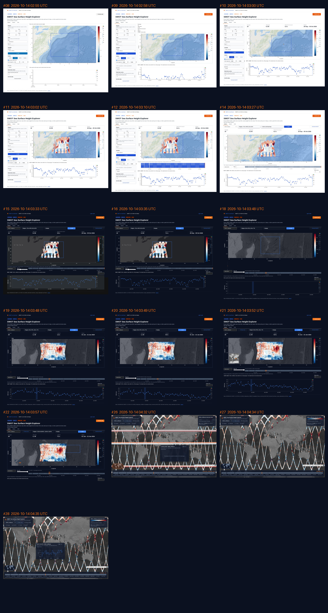

# SWOT Sea Surface Height Explorer

A web map over every SWOT KaRIn L3 swath (AVISO v3.0 Basic, 2 km), read on demand from an
[IceChunk](https://icechunk.io) store in the cloud: pick a region and up to 21 days, click a point for
its time series, and copy the icechunk + xarray code that gives you the same data.

The store is built by [swot_icechunk](https://github.com/iuryt/swot_icechunk). `app/` is the
Hugging Face Space (FastAPI + MapLibre). Run locally with `pixi run serve`.

